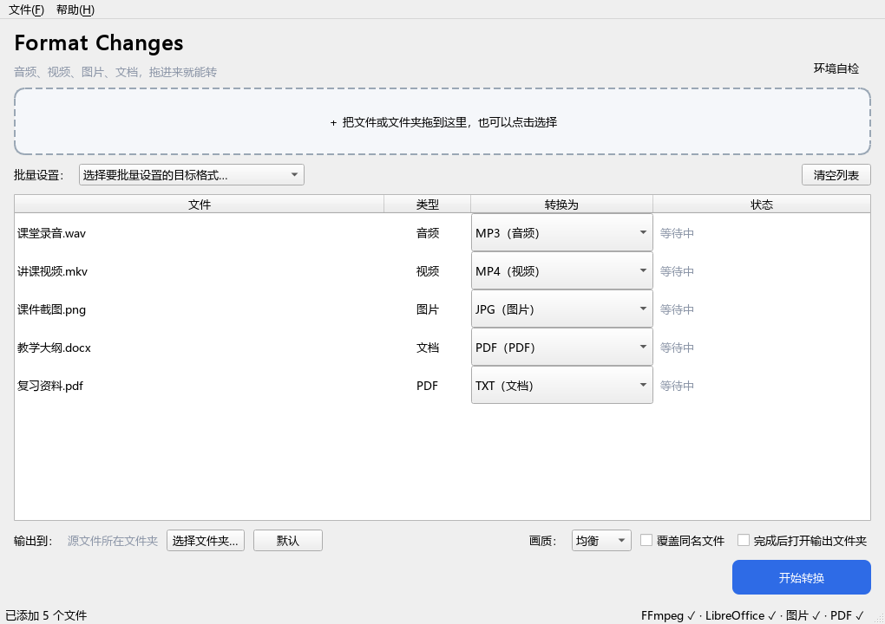

# Format Changes

一个送给计算机老师的小礼物：**把常见的音频、视频、图片、文档格式互相转换**的桌面软件。
拖进文件 → 选目标格式 → 点一下，就转好了。



## 支持的转换

| 类别 | 可以转成 |
|---|---|
| 🎵 音频 | MP3、OGG、WAV、FLAC、M4A、AAC、OPUS、WMA |
| 🎬 视频 | MP4、MKV、MOV、WEBM、AVI、WMV、FLV、GIF（做动图）以及"提取音频"（视频→MP3/OGG/…） |
| 🖼 图片 | PNG、JPG、WEBP、BMP、TIFF、ICO、PDF（HEIC 需可选项支持） |
| 📄 Word 文档 | PDF、DOCX、ODT、RTF、TXT、HTML |
| 📊 表格 | PDF、XLSX、XLS、ODS、CSV、HTML |
| 📽 演示文稿 | PDF、PPTX、PPT、ODP |
| 📕 PDF | TXT（提取文字）、DOCX（转 Word，基础模式） |

工程细节：支持**批量转换**（整页队列、每个文件单独选格式）、**拖拽文件夹自动扫描**、
**四种画质预设**、**自动避免覆盖同名文件**、**随时取消**、转换完成双击即可打开文件。

## 工作原理（为什么要 LibreOffice？）

| 组件 | 负责什么 | 是否随 App 打包 |
|---|---|---|
| FFmpeg | 音频 / 视频 / GIF | ✅ 自动打包（约 70MB），无需安装 |
| Pillow | 图片 | ✅ Python 库 |
| PyMuPDF | PDF 读取 | ✅ Python 库 |
| **LibreOffice** | Word / Excel / PPT → PDF 等 | ❌ 体积太大，检测到已安装才会用 |

LibreOffice 是被当成"看不见的文档渲染引擎"调用的（无头模式），老师不需要打开它。
**没装 LibreOffice 也能用**：`docx → PDF/TXT` 会自动使用内置"基础模式"（文字、标题、表格都在，复杂排版会简化）。
装了 LibreOffice 则输出效果和原文档一致，还支持表格/PPT 全部转换。

## 在 Windows 上开发和测试（你现在的位置）

```powershell
python -m venv .venv
.\.venv\Scripts\Activate.ps1
pip install -r requirements.txt
python main.py            # 打开图形界面
```

命令行模式（方便快速验证）：

```powershell
python main.py --cli 录音.mp3 -t ogg
python main.py --cli 讲课视频.mkv -t mp4 -q high
python main.py --cli 讲义.docx -t pdf
python main.py --cli 整个文件夹 -t mp3
python main.py --cli --check          # 检查运行环境
python main.py --cli 文件.pdf --list  # 看某文件能转什么
```

自检（真实转换各种格式，跑完会告诉你结果）：

```powershell
python tests\smoke_cli.py
```

## 打包给老师（重点）

Windows 上没法直接生成 macOS 的 `.app`，但 **git 仓库推上去后，GitHub 的免费 macOS 机器会帮你打包**，
你只需要下载产物、发给老师。两条路任选：

### 方法 A：没有 Mac，用 GitHub Actions 云端打包（推荐）

1. 在 GitHub 建一个仓库（公开/私有都行），把本项目所有文件传上去；
2. 打开仓库页面 → **Actions** 标签 → 左侧「构建 macOS 应用」→ **Run workflow**；
3. 等 5~10 分钟，构建完成后在该次运行页面最下方下载 **FormatChanges-macOS** 产物（含 dmg 和 zip）；
4. 首选把 **dmg** 发给老师（打开后把 App 拖进「应用程序」即安装）；也可以直接把 Release 链接发给老师
   （免登录、永久有效）：https://github.com/furliflix/format-changes/releases/latest

默认构建的是 Apple 芯片（M1/M2/M3…）版本。如果老师是老的 Intel Mac，
把 `.github/workflows/build-macos.yml` 里的 `runs-on: macos-14` 改成 `macos-13` 再跑一次。

### 方法 B：有 Mac，本机一键打包

```bash
bash packaging/build_macos.sh
```

产出 `dist/FormatChanges-<架构>.dmg`（推荐，拖进「应用程序」即安装）和 `dist/FormatChanges-macOS-<架构>.zip`（备用，内含 App 和说明）。

### 老师第一次打开被系统拦怎么办？

没花钱做 Apple 签名/公证的 App，macOS 会提示"无法验证开发者"（这是正常现象）。两个办法任选：

1. **右键点 App → 打开 → 再点"打开"**；之后就能正常双击了；
2. 或者在"终端"里执行一次：`xattr -cr "/Applications/Format Changes.app"`

`packaging/给老师的说明.txt` 里已经写好了这两步，跟 App 一起发给老师即可。

### 方法 C：老师电脑有 Python（兜底）

`packaging/run_from_source.command` 双击即可运行源码版（首次会联网装依赖）。

## 图标说明

当前图标由脚本绘制：**黑白配色（黑底白箭头 ⇄）**，4 倍超采样，小尺寸下也很清晰。

想换风格或配色，一行命令重新生成（PNG / ICO / iconset 全套尺寸）：

```bash
python packaging/make_icon.py --scheme light    # 白底黑箭头
python packaging/make_icon.py --style cycle     # 环形循环箭头
python packaging/make_icon.py --scheme blue     # 蓝紫渐变色
```

想换成自己画的设计（Affinity 等）：

- 画布 **1024×1024**、透明背景，图案控制在中间 **约 830×830** 内（四周留 ~96px，符合 macOS 图标规范）；
- 导出 PNG 后运行：`python packaging/make_icon.py --from 你的图.png`；
- 重新打包即可（macOS 打包脚本会自动用 iconutil 生成 .icns）。

## 打包前自定义（重要）

打开 `app/__init__.py`，把开头这几行改成你自己的信息：

```python
APP_NAME = "Format Changes"   # 显示名字
APP_AUTHOR = "你的名字"
APP_DEDICATION = "送给敬爱的计算机老师"
```

`APP_AUTHOR` 和 `APP_DEDICATION` 会出现在「关于」窗口里。
注意：项目文件夹名（FormatWizard）只是工程代号，不影响 App 的任何显示效果；
GitHub 仓库名也可以随便取。

## 项目结构

```
FormatWizard/                  # 工程目录（名字随意）
├── main.py                    # 启动入口（图形界面 / 命令行）
├── app/
│   ├── gui.py                 # PySide6 图形界面
│   ├── cli.py                 # 命令行模式
│   ├── __init__.py            # 名字、版本、作者（要改的就是这里）
│   └── core/
│       ├── engine.py          # 转换引擎：路由、进度、输出命名
│       ├── deps.py            # 探测 FFmpeg / LibreOffice
│       ├── formats.py         # 格式登记表、画质预设
│       └── backends/          # 各引擎的具体实现
│           ├── ffmpeg.py      # 音视频、GIF 两遍调色板法
│           ├── images.py      # Pillow 图片
│           ├── office.py      # LibreOffice 无头模式
│           ├── pdf.py         # PyMuPDF：PDF → TXT / DOCX
│           └── simple.py      # 无 LibreOffice 时的"基础模式"
├── packaging/
│   ├── build_macos.sh         # macOS 一键打包
│   ├── build_windows.ps1      # Windows 打包（自己测试用）
│   ├── make_icon.py           # 生成图标
│   ├── 给老师的说明.txt        # 随 App 一起发给老师的说明
│   └── run_from_source.command# 老师电脑直接跑源码的脚本
├── tests/
│   ├── smoke_cli.py           # 全格式自检
│   └── smoke_gui.py           # 界面冒烟测试 + 截图
├── .github/workflows/build-macos.yml   # 云端打包 macOS 应用
└── FormatChanges.spec         # PyInstaller 打包配置
```

## 常见问题

- **转 Word/PPT 提示"需要安装 LibreOffice"？** 按上面方法装一下即可；只想转 docx→PDF/TXT 的话不装也能用。
- **音频/视频转换**：引擎是打包自带的，什么都不用装。
- **老师 Mac 上没有 Python 也没关系**：打包好的 App 内置了 Python 环境。
- **App 有点大（约 250MB）**：因为内置了 FFmpeg 和 Python + Qt 运行库，属正常现象。
- **要不要做 Apple 签名/公证？** 不做也能用（右键打开一次即可），做的话需要 99 美元/年的开发者账号。
